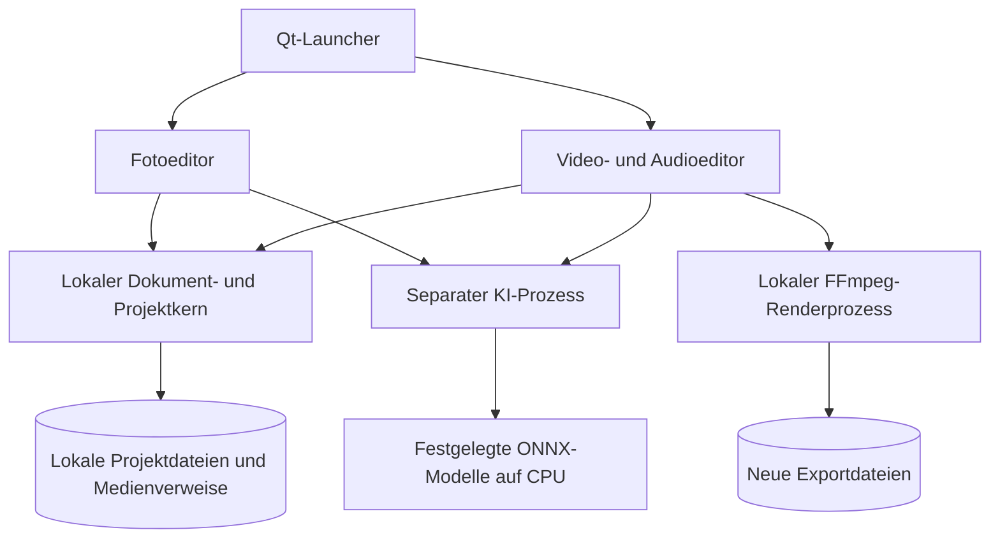

<picture>
  <source media="(prefers-color-scheme: dark)" srcset="docs/branding/banner-dark.svg">
  
</picture>

# Edivora

**Marke und UI-Design:** [Logo sowie helle und dunkle Designvorlagen](docs/branding/README.md) (Konzeptgrafiken, keine Produktscreenshots).

**Foto, Video und Audio lokal bearbeiten – mit ausgewählten KI-Funktionen.**

**Sprache:** [English](README.md) · **Deutsch**

[](https://github.com/Cenn0/Edivora/actions/workflows/python-checks.yml)
[](LICENSE)

**Direkt zu:** [Funktionen](#funktionen) · [Architektur](#architektur) · [Quellcode-Start](#aus-dem-quellcode-starten) · [Dokumentation](docs/README.md) · [Roadmap](docs/ROADMAP.md) · [Mitwirken](docs/CONTRIBUTING.md)

**Oberflächenvorschau** – [deutschen UI-Test-Screenshot ansehen](docs/screenshots/ui-smoke-de.png):

<a href="docs/screenshots/ui-smoke-de.png"></a>

Der Screenshot zeigt den Entwicklungsstand im Quellcode, kein veröffentlichtes Windows-Paket.

Edivora ist eine Open-Source-Desktop-Suite mit deutsch- und englischsprachiger Oberfläche. Die Bearbeitung läuft lokal, ohne Benutzerkonto oder Cloud-KI. KI-Modelle müssen vor der ersten Nutzung separat vorbereitet werden; die Anwendung lädt sie nicht automatisch herunter.

> **Version: 0.4.0a1 (Entwicklungsquellcode).** Für die aktuelle Suite existiert **kein veröffentlichtes Windows-Paket**. Vor einer gemeinsamen Binärverteilung müssen die Weiterverteilungsbedingungen für Qt/FFmpeg/Modelle und die Kompatibilität auf den Zielsystemen überprüft werden. Historische Foto-Testpakete enthalten weder den aktuellen Launcher noch Video- und Audiofunktionen.

## Funktionen

| Editor | Im aktuellen Quellcode | Wichtige Grenzen |
| --- | --- | --- |
| **Foto** | JPEG/PNG/WebP, Licht und Farbe, Looks, Zuschnitt, Drehung, Vorher/Nachher, Undo/Redo, lokale Motivfreistellung mit U2NETP und `.laip`-Projekte | Keine Ebenen, RAW/HDR-Unterstützung oder generative Textbearbeitung |
| **Video** | Bis zu 24 Clips auf einer Timeline anordnen, trimmen, teilen und duplizieren; Bildkorrekturen, `.edvp`-Projekte und MP4-Export; lokale KI-Freistellung eines Standbilds und kurze DnCNN-Entrauschung | Gesamte Sequenz nur nach Vorab-Rendern bis 2 Minuten; keine Live-Mehrspurvorschau oder Übergänge |
| **Audio** | Bis zu 24 Clips auf einer Timeline, Trimmen, Pegel, Fades, WAV/MP3-Export, `.edap`-Projekte und lokale Spracherkennung von Abschnitten mit Silero VAD | Kein Mehrspurmix, keine Transkription und keine KI-Rauschunterdrückung |

Der Launcher öffnet Foto, Video und Audio in **getrennten Fenstern** und bleibt für weitere Starts verfügbar. Bearbeitete Dateien werden separat exportiert; das Original soll nicht überschrieben werden.

**Grenzen der KI:** DnCNN verarbeitet auf der CPU ausgewählte Videoabschnitte bis **30 Sekunden bei maximal 720p/30 fps**. Das Ergebnis kann Details verlieren oder flimmern. Eingebrannte Filter und bereits verlorene Bildinformationen lassen sich nicht zuverlässig rekonstruieren. **GPU/CUDA/DirectML sind projektseitig nicht verifiziert.** `.edvp`- und `.edap`-Projektdateien verweisen auf Quelldateien und können absolute lokale Pfade enthalten.

## Architektur

Edivora ist eine **lokale Qt-Desktop-Suite**, kein Web- oder Clouddienst. Der Launcher öffnet unabhängige Editorfenster; KI-Verarbeitung und Medienexport werden in begrenzten lokalen Prozessen ausgeführt.



Der [Architekturleitfaden](docs/ARCHITECTURE.md) beschreibt die Modulgrenzen. Der KI-Prozess verbessert Reaktionsfähigkeit und Abbruchverhalten, ist aber **keine Sicherheits-Sandbox**. Modelldateien werden nur während einer ausdrücklich gestarteten Vorbereitung geladen. Video-/Audioprojekte können lokale Dateipfade enthalten; vor dem Weitergeben prüfen.

## Aus dem Quellcode starten

Für den aktuellen Entwicklungsstand wird **Python 3.12** empfohlen. Unter Windows im Repository-Verzeichnis:

```powershell
py -3.12 -m venv .venv
.venv\Scripts\python -m pip install -e .
.venv\Scripts\python tools\prepare_model.py
.venv\Scripts\python tools\prepare_voice_model.py
.venv\Scripts\python -m pip install torch==2.14.1 --index-url https://download.pytorch.org/whl/cpu
.venv\Scripts\python -m pip install onnx==1.23.2
.venv\Scripts\python tools\prepare_restoration_model.py
.venv\Scripts\python -m local_ai_photo_editor
```

Die Modellvorbereitung benötigt Internetzugang und prüft festgelegte Modellartefakte. Der letzte Befehl öffnet den Launcher. Einzelne Editoren starten mit `--tool photo`, `--tool video` oder `--tool audio`.

Der derzeitige Windows-Entwicklungsbuild verwendet noch den Dateinamen `LocalAiPhotoEditor.exe` und benötigt seinen vollständigen Begleitordner. Eine herunterladbare `Edivora.exe` der aktuellen Suite ist **nicht verfügbar**. Weitere Hinweise: [Erste Schritte](docs/GETTING_STARTED.md).

## Entwickeln und testen

Technische Basis: **Python 3.12**, **PySide6/Qt**, **Pillow/NumPy**, **ONNX Runtime (CPU)** und **FFmpeg** für den Medienexport.

```powershell
.venv\Scripts\python -m unittest discover -s tests -v
.venv\Scripts\python -m compileall -q src tests tools
```

Automatisierte Tests belegen nur die jeweils getesteten Fälle; sie ersetzen weder die Prüfung der Modellqualität noch die Prüfung der Weiterverteilungsrechte für installierbare Windows-Binärpakete. Mediendateien werden mit nativen Decodern verarbeitet und sind **keine vertrauenswürdigen Eingaben**.

## Dokumentation

[Erste Schritte](docs/GETTING_STARTED.md) · [Funktions- und Projektformate](docs/MEDIA_PROJECTS_AI.md) · [KI-Modelle](docs/MODELS.md) · [Videoverbesserung](docs/VIDEO_RESTORATION.md) · [Architektur](docs/ARCHITECTURE.md) · [Roadmap](docs/ROADMAP.md) · [Beitragen](docs/CONTRIBUTING.md) · [Sicherheitsrichtlinie](SECURITY.md)

## Lizenz und Veröffentlichung

Der Anwendungscode steht unter [Apache-2.0](LICENSE). **Qt, FFmpeg, Modelle und weitere Drittkomponenten haben eigene Bedingungen**; eine öffentliche Binärveröffentlichung benötigt eine gesonderte Prüfung. Siehe [Drittanbieterhinweise](THIRD_PARTY_NOTICES.md) und [Veröffentlichungscheckliste](docs/PUBLIC_RELEASE_CHECKLIST.md).
