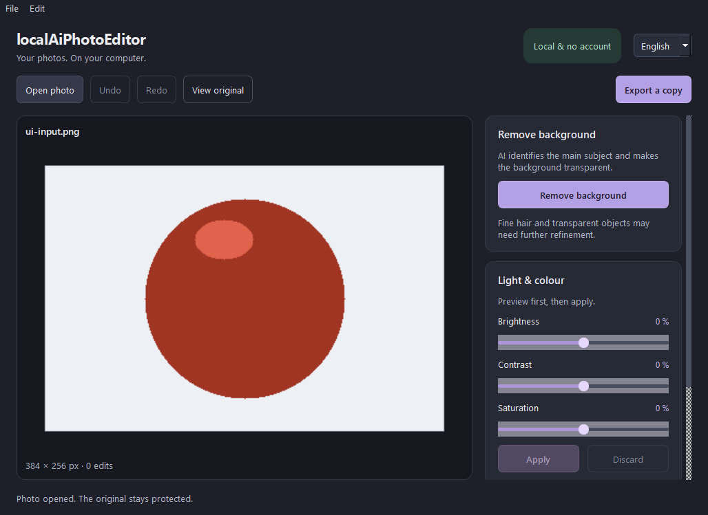

# LocalAiPhotoEditor

**A beginner-friendly desktop photo editor with local AI background removal.** Edit photos without an account, cloud service, or model server. Image processing and inference run on your computer.

[Deutsch](README.md) · [English](README.en.md) · [Contributing](CONTRIBUTING.md) · [AI-assisted development](docs/AI_WORKFLOW.md)

> **Early development.** The portable `v0.1.0-alpha.1` Windows download is an **unsigned test alpha**, not a stable release. `main` has additional source features that are **not in that published ZIP**. The existing package verification applies only to its recorded build, not every newer revision. See [verification evidence](docs/VERIFICATION.md).



## Choose your starting point

| I want to… | Start here |
| --- | --- |
| Try the app without coding | [Run the Windows alpha](#try-the-windows-alpha) |
| Set up a development workspace | [Run from source](#run-from-source) |
| Contribute a change, with or without AI | [CONTRIBUTING.md](CONTRIBUTING.md) |
| Give an AI coding agent a GitHub URL and a task | [AI workflow and prompts](docs/AI_WORKFLOW.md) |
| Understand modules and boundaries | [Architecture](docs/ARCHITECTURE.md) |

## Try the Windows alpha

The target platform is **Windows 11 x64**, but the published automated package tests were performed on **Windows Server 2022**. Clean Windows 11 acceptance is still outstanding.

1. [Download `LocalAiPhotoEditor-0.1.0-alpha.1-windows-x64.zip`](https://github.com/Cenn0/LocalAiPhotoEditor/releases/download/v0.1.0-alpha.1/LocalAiPhotoEditor-0.1.0-alpha.1-windows-x64.zip) ([release information](https://github.com/Cenn0/LocalAiPhotoEditor/releases/tag/v0.1.0-alpha.1)).
2. Extract **the entire ZIP** into a local directory.
3. Start `LocalAiPhotoEditor/LocalAiPhotoEditor.exe`, open an image, edit, and export to a **new filename**.

The complete ZIP includes the application, runtime and pinned AI model. It does **not** require Python, CUDA, Docker, or a separate model download. Check `SHA256SUMS.txt` from the same release. **The repository is currently private; GitHub access is required** for its downloads and code.

**In the released ZIP:** JPEG/PNG/WebP import, basic color/lighting edits, rotation, crop and resize, CPU AI background removal, before/after, undo/redo, DE/EN UI, and local export. The original image is protected against overwrite. Export strips original EXIF/GPS/comment metadata; PNG/WebP can preserve alpha, while JPEG fills transparent areas with white.

## What is available where?

| Capability | Published alpha ZIP | Current `main` source |
| --- | :---: | :---: |
| Basic editing, export and local U2NETP background removal | Yes | Yes |
| Guided light/look/crop/background editor | No | Yes |
| Subject-aware AI effects | No | Yes |
| Manual alpha-mask correction | No | Yes |
| Local `.laip` project files | No | Yes |
| Generative text editing or supported GPU acceleration | No | No |

Separate branches and open PRs **are not automatically part of `main`**. Source availability is not packaged-release certification. Consult the [roadmap](docs/ROADMAP.md) and feature documentation for exact limits.

## Run from source

Use **Python 3.12**, Git and an internet connection for initial development dependency installation. Windows PowerShell:

```powershell
git clone https://github.com/Cenn0/LocalAiPhotoEditor.git
cd LocalAiPhotoEditor
py -3.12 -m venv .venv
.\.venv\Scripts\python.exe -m pip install -e .
.\.venv\Scripts\python.exe -m local_ai_photo_editor
```

To enable real AI inference **in a source checkout**, explicitly download and integrity-check the pinned model once:

```powershell
.\.venv\Scripts\python.exe tools\prepare_model.py
```

This is a **build/development-time download**, not a runtime download. Do not commit the model file. Source setup and Linux instructions, tests, debugging and verification levels are in [DEVELOPMENT.md](docs/DEVELOPMENT.md). Python 3.12 is the CI-tested version; additional versions permitted by `pyproject.toml` are not automatically certified.

## Develop with AI

AI agents can explain code, make changes, add tests, and draft PRs. A GitHub link alone **does not grant private repository access**: connect an authorized GitHub tool or share the needed files.

Start with one small task and give your agent this prompt:

```text
Work on Cenn0/LocalAiPhotoEditor, based on current main.
First read AGENTS.md, CONTRIBUTING.md, and docs/DEVELOPMENT.md.
Then inspect only the source and tests relevant to this task.

Task: [describe one specific fix or link an issue]

Summarize the current behavior and a small implementation plan.
Make the change on a new branch, add focused tests, and keep DE/EN UI
strings and documentation consistent. Preserve local-only image processing,
source-file overwrite protection, and the current architecture.
Run applicable checks, report failures/skips/unverified items truthfully,
and open a PR. Do not merge without approval.
If you lack repository access, ask for only the required files.
```

Full guide: [AI_WORKFLOW.md](docs/AI_WORKFLOW.md). Normal contribution process: [CONTRIBUTING.md](CONTRIBUTING.md). Agent repository rules: [AGENTS.md](AGENTS.md).

## Architecture at a glance

| Location | Purpose |
| --- | --- |
| `src/local_ai_photo_editor/core/` | Qt-free image operations, document/history, masks, recipes, projects |
| `src/local_ai_photo_editor/ui/` | Qt windows/dialogs, previews and German/English strings |
| `src/local_ai_photo_editor/ai/` | Verified, local ONNX model and inference |
| `src/local_ai_photo_editor/worker.py` | Separate inference process |
| `tests/` | Core, UI, AI-protocol and persistence tests |
| `tools/` | Explicit model preparation, verification and packaging |
| `.github/workflows/` | Source checks, Windows builds, offline package checks |

The separate process supports cancellation and UI responsiveness; it is **not** an OS security sandbox.

## Limitations, licensing and documentation

Current input is limited to single-frame 8-bit images up to **40 megapixels**. No RAW/16-bit/multipage workflow, segmentation accuracy benchmark, generative editing, or supported GPU path is claimed. U2NETP detects subject areas; it does **not** generate missing detail. No stable end-user release or macOS/Linux package is claimed.

The running app has no account, telemetry or built-in cloud upload; explicit install/build downloads are separate. Files in a user-selected synchronized folder may be uploaded by third-party sync software.

The **application code** uses Apache-2.0. Separate ONNX artifact redistribution rights and Qt/LGPL packaging obligations must be resolved before public redistribution; see [model provenance](docs/MODELS.md) and [third-party notices](THIRD_PARTY_NOTICES.md).

Start with the [documentation index](docs/README.md), then [architecture](docs/ARCHITECTURE.md), [development](docs/DEVELOPMENT.md), [AI workflow](docs/AI_WORKFLOW.md), [roadmap](docs/ROADMAP.md) and [verification](docs/VERIFICATION.md).
