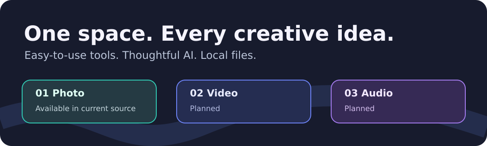

# Edivora

**Simple, local photo, video and audio editing with selected on-device AI features.** Edivora is being developed as a free, open-source desktop toolkit with German and English UI. **The GitHub repository is currently private**, and the current suite has not been published as a public end-user release. No account, cloud model server or runtime model downloads are needed.

**Language:** [Deutsch](README.md) · English (this page)



> **Source code is not a product release.** The [published `v0.1.0-alpha.1` ZIP](https://github.com/Cenn0/Edivora/releases/tag/v0.1.0-alpha.1) contains the **older photo-only test alpha**, not the multi-tool launcher. The latest `main` source is the **0.3.0a1** three-workspace development baseline. A private, unsigned Windows test package is provided above; a fully accepted Windows 11 public release has **not** been approved. License/codec and clean-machine checks are pending.

## Download the latest Windows development test build

**[Windows x64: Download Edivora 0.3.0 Alpha 1 (ZIP)](https://github.com/Cenn0/Edivora/releases/download/v0.3.0-alpha.1/Edivora-0.3.0-alpha.1-windows-x64.zip)** · [SHA-256 checksum](https://github.com/Cenn0/Edivora/releases/download/v0.3.0-alpha.1/SHA256SUMS.txt) · [Private prerelease notes](https://github.com/Cenn0/Edivora/releases/tag/v0.3.0-alpha.1) · [Build provenance](https://github.com/Cenn0/Edivora/releases/download/v0.3.0-alpha.1/BUILD_PROVENANCE.json)

This is a **private, unsigned prerelease** for authorized repository users, **not an officially accepted Windows 11 product release**. Publication is gated on a successful Windows CI package build; if the run is not green, no new release is published. Unlike the older photo alpha below, this build includes the launcher and all three editors.

**Installation:** Download the ZIP and `SHA256SUMS.txt`, compare the ZIP SHA-256 using `Get-FileHash .\Edivora-0.3.0-alpha.1-windows-x64.zip -Algorithm SHA256` in PowerShell, extract **all** files and launch **`LocalAiPhotoEditor/LocalAiPhotoEditor.exe`**. The technical executable name is still historical; the UI is branded **Edivora**. Keep the complete Qt, model and FFmpeg directories. Python or Docker are not needed on the target computer. **Do not redistribute publicly:** FFmpeg/Qt/model licence review and fresh Windows 11 acceptance are not complete. [Release notes](docs/RELEASE_NOTES_TEST_SUITE.md) · [Windows CI builds](https://github.com/Cenn0/Edivora/actions/workflows/windows-alpha.yml).

## Current source capabilities

| Workspace | Implemented | Not implemented / limit |
| --- | --- | --- |
| **Photo** | JPEG/PNG/WebP import/export, adjustments and looks, crop/rotate, original comparison and undo/redo, local U2NETP foreground selection, alpha-mask correction, editable `.laip` photo projects | No layers, RAW/HDR or generative prompt editing |
| **Video** | Single ordered lane with up to **24 clips**, trim/split/duplicate/reorder, `.edvp` linked-source projects, MP4 export, local segmentation of **one selected still frame** to PNG | No multitrack overlays, transitions, continuous full-sequence preview or full-video AI; export standardizes to 1280×720/30fps MPEG-4 Part 2 and AAC |
| **Audio** | Up to **24 clips** in one lane, trim/split/reorder, volume, optional normalization/fades, `.edap` projects, WAV/MP3 export, local **Silero VAD** speech-region suggestions | No multitrack mix, speech-to-text transcription or neural noise reduction |

One **launcher** starts Photo, Video and Audio in separate independent windows; open any one, any two or all three at once. Project files preserve editing state; exporting creates a **separate new media file**. `.edvp/.edap` reference source files rather than embedding them and may expose absolute local paths, so they are not automatically portable.

**AI scope:** Current `main` uses local, pinned **U2NETP and Silero VAD ONNX CPU** models. Classic image/audio adjustments are **not generative AI**. No application-level CUDA/DirectML/other GPU deployment has been verified; automatic GPU support should not be inferred from a compatible card. The proposed expanded model profiles in PR #17 are **not on `main`**.

## Download the historical photo alpha

The existing [Windows x64 test package](https://github.com/Cenn0/Edivora/releases/download/v0.1.0-alpha.1/LocalAiPhotoEditor-0.1.0-alpha.1-windows-x64.zip) is **unsigned**. Verify its hash using [SHA256SUMS.txt](https://github.com/Cenn0/Edivora/releases/download/v0.1.0-alpha.1/SHA256SUMS.txt), unpack the **entire** ZIP and run `LocalAiPhotoEditor/LocalAiPhotoEditor.exe`. You can import a photo, make basic corrections, remove its background locally and export a copy. **Video, Audio and project files are not available in that ZIP.**

The historical package passed 69 tests and actual CPU inference plus native/offline packaging checks on Windows Server 2022. These results do not verify the new suite or a clean Windows 11 install. [Exact historical evidence](docs/VERIFICATION.md).

## Run the latest development source

Use **Python 3.12**. Preparing pinned model weights is an **explicit build/developer step with network access**, never a silent application download.

```powershell
py -3.12 -m venv .venv
.venv\Scripts\python -m pip install -e .
.venv\Scripts\python tools\prepare_model.py
.venv\Scripts\python tools\prepare_voice_model.py
.venv\Scripts\python -m local_ai_photo_editor
```

Directly launch a workspace:

```powershell
.venv\Scripts\python -m local_ai_photo_editor --tool photo
.venv\Scripts\python -m local_ai_photo_editor --tool video
.venv\Scripts\python -m local_ai_photo_editor --tool audio
```

The current development Windows build still names its executable **`LocalAiPhotoEditor.exe`**, despite Edivora branding. It is a **standalone directory**, not a one-file binary; keep its bundled Qt, models and FFmpeg files together.

## Contributing and safety boundaries

- **Originals are never intentionally overwritten.** Exports are validated and atomically installed after rendering. Native media decoders are **not** a sandbox; source files, project manifests and ZIP archives must be treated as untrusted.
- No account, telemetry, runtime-cloud inference or remote image/audio/video upload is built into the app. A user-selected synced export folder may still be synced by third-party software.
- Source modules: `ui/` (Qt and DE/EN strings), `core/` (Qt-free image/media logic and format validation), `ai/` (bounded, locally verified models), plus separate worker/FFmpeg processes.
- The code is **Apache-2.0**. Qt, FFmpeg and model artifacts have separate licensing, attribution and redistribution requirements; a new public Windows suite must pass those checks.

Start with [AGENTS.md](AGENTS.md), [contributor guide](docs/CONTRIBUTING.md), [architecture](docs/ARCHITECTURE.md), [media-project details](docs/MEDIA_PROJECTS_AI.md), [brand assets](docs/BRAND.md), [roadmap](docs/ROADMAP.md), and the [documentation index](docs/README.md). Distinguish implemented source, verified tests, distributed packages and official support.
