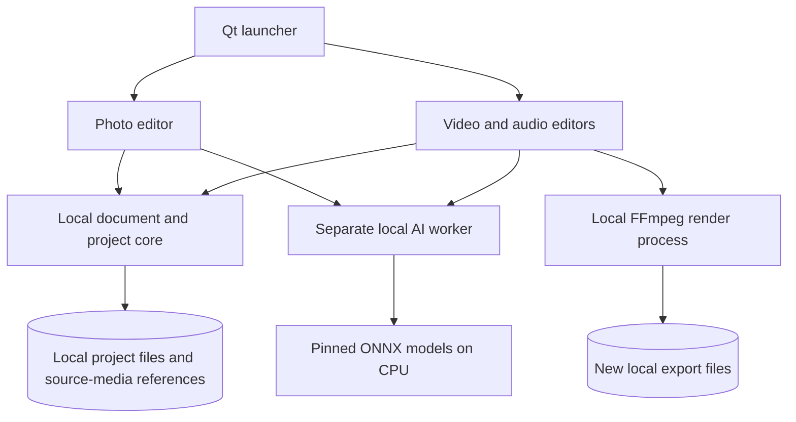

<picture>
  <source media="(prefers-color-scheme: dark)" srcset="docs/branding/banner-dark.svg">
  
</picture>

# Edivora

**Brand and UI design:** [Logo and light/dark design templates](docs/branding/README.md) (concept artwork, not product screenshots).

**Edit photos, video and audio locally, with selected on-device AI tools.**

**Language:** **English** · [Deutsch](README.de.md)

[](https://github.com/Cenn0/Edivora/actions/workflows/python-checks.yml)
[](LICENSE)

**Explore:** [Features](#features) · [Architecture](#architecture) · [Source setup](#run-from-source) · [Docs](docs/README.md) · [Roadmap](docs/ROADMAP.md) · [Contribute](docs/CONTRIBUTING.md)

**Interface preview** — [view the committed English UI test capture](docs/screenshots/ui-smoke-en.png):

<a href="docs/screenshots/ui-smoke-en.png"></a>

This screenshot shows the current development source, not a packaged Windows release.

Edivora is an open-source desktop suite with English and German interfaces. Editing happens locally, without an account or cloud AI. Models must be prepared separately before use; the application does not download them at runtime.

> **Version: 0.4.0a1 (development source).** There is **no published Windows package of the current suite**. Third-party Qt/FFmpeg/model redistribution obligations and target-system compatibility need verification before distributing any combined binary bundle. Historical photo-only test packages do not include the current launcher or the video/audio editors.

## Features

| Editor | Implemented in the current source | Main limitations |
| --- | --- | --- |
| **Photo** | JPEG/PNG/WebP, color and light adjustments, looks, crop/rotate, before/after, undo/redo, local U2NETP subject masking and `.laip` projects | No layers, RAW/HDR or prompt-based generative editing |
| **Video** | Arrange, trim, split and duplicate up to 24 clips in one lane; picture adjustments, `.edvp` projects and MP4 export; local still-frame subject masking and short-clip DnCNN denoising | Only pre-rendered full-sequence previews up to 2 minutes; no realtime multitrack preview or transitions |
| **Audio** | Up to 24 clips in one lane; trimming, levels, fades, WAV/MP3 export, `.edap` projects and local Silero VAD speech-region suggestions | No multitrack mixing, transcription or neural noise reduction |

The launcher can open Photo, Video and Audio in **separate windows** while remaining open. Export creates a separate file rather than intentionally overwriting the original.

**Project recovery:** Previously saved `.edvp` and `.edap` projects create local recovery checkpoints about every 15 seconds while edited and idle. Opening a newer valid checkpoint requires confirmation; the saved project is not replaced until an explicit Save. New never-saved projects and `.laip` photo projects do not have this recovery mechanism, and media files are not bundled into portable archives.

**AI boundaries:** On CPU, DnCNN processes selected video sections of up to **30 seconds, 720p and 30 fps**. Processing may remove detail or cause flicker. Baked-in filters and lost image detail cannot be reliably reversed. **GPU/CUDA/DirectML operation has not been verified by this project.** `.edvp` and `.edap` project files reference source media and may contain absolute local paths.

## Architecture

Edivora is a **local Qt desktop suite**, not a web or cloud service. The launcher opens separate editor windows, while CPU inference and media rendering run as bounded local jobs.



The [architecture guide](docs/ARCHITECTURE.md) describes the code boundaries. The worker process provides responsiveness and cancellation, **not a security sandbox**. Model downloads occur only during explicit preparation, never implicitly when the editor starts. Video/audio project files may include local filesystem paths: review them before sharing.

## Run from source

The current development instructions use **Python 3.12**. From the repository root on Windows:

```powershell
py -3.12 -m venv .venv
.venv\Scripts\python -m pip install -e .
.venv\Scripts\python tools\prepare_model.py
.venv\Scripts\python tools\prepare_voice_model.py
.venv\Scripts\python -m pip install torch==2.14.1 --index-url https://download.pytorch.org/whl/cpu
.venv\Scripts\python -m pip install onnx==1.23.2
.venv\Scripts\python tools\prepare_restoration_model.py
.venv\Scripts\python -m local_ai_photo_editor
```

Model preparation requires network access and checks pinned model artifacts. The final command launches the editor selection window. Use `--tool photo`, `--tool video` or `--tool audio` to launch one editor directly.

The Windows development build is still called `LocalAiPhotoEditor.exe` and needs its accompanying directory. A downloadable `Edivora.exe` for the current suite is **not available**. See [Getting started](docs/GETTING_STARTED.md).

## Develop and test

The main stack is **Python 3.12**, **PySide6/Qt**, **Pillow/NumPy**, **ONNX Runtime (CPU)** and **FFmpeg** for media export.

```powershell
.venv\Scripts\python -m unittest discover -s tests -v
.venv\Scripts\python -m compileall -q src tests tools
```

Automated checks cover specific cases; they do not establish model quality, safe media decoding or legal compliance for redistributed Windows binaries. Treat incoming media as **untrusted**.

## Documentation

[Getting started](docs/GETTING_STARTED.md) · [Media projects and AI](docs/MEDIA_PROJECTS_AI.md) · [Models](docs/MODELS.md) · [Video restoration](docs/VIDEO_RESTORATION.md) · [Architecture](docs/ARCHITECTURE.md) · [Roadmap](docs/ROADMAP.md) · [Contributing](docs/CONTRIBUTING.md) · [Security policy](SECURITY.md)

## License and distribution

Application source code is licensed under [Apache-2.0](LICENSE). **Qt, FFmpeg, AI models and other third-party components have separate terms.** Public binary distribution requires a further compliance review. See [third-party notices](THIRD_PARTY_NOTICES.md) and the [public release checklist](docs/PUBLIC_RELEASE_CHECKLIST.md).
