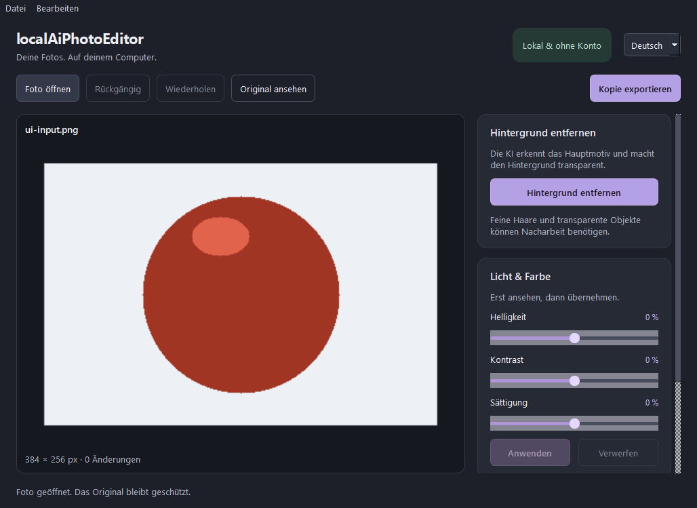

# Edivora

**Language:** Deutsch (dieses README) · [English README](README.en.md)

**Foto, Video und Audio einfach bearbeiten – mit ausgewählten lokalen KI-Funktionen.** Edivora wird als kostenloses Open-Source-Werkzeug für gelegentliche Bearbeitung entwickelt; **der Quellcode ist öffentlich**, während die Freigabe öffentlicher Windows-Binärpakete noch aussteht. Für die Bearbeitung sind weder Konto noch Modellserver oder Cloud-Verarbeitung vorgesehen. Die Oberfläche ist auf **Deutsch und Englisch** verfügbar.


> **Quellcode ist nicht gleich freigegebenes Windows-Paket.** `main` enthält die aktuelle Foto-/Video-/Audio-Suite (0.3.0a1). Die frühere Foto-Testalpha `v0.1.0-alpha.1` ist nicht dieselbe Anwendung. Bereits bereitgestellte Binärdateien werden bis zur abschließenden Prüfung der Qt-, FFmpeg- und KI-Modell-Rechte zurückgezogen.

## Windows-Downloadstatus

**Aktuell gibt es keine öffentlich zur Weiterverteilung freigegebene Windows-ZIP.** Portable Builds enthalten Drittanbieterprogramme, Qt-Bibliotheken und KI-Modellgewichte mit eigenen Bedingungen. Siehe [Drittanbieterhinweise](THIRD_PARTY_NOTICES.md), [Roadmap](docs/ROADMAP.md) und [Quellcode-Einstieg](docs/GETTING_STARTED.md). Ein erfolgreicher CI-Build ist weder eine Lizenzfreigabe noch eine Windows-11-Endnutzerabnahme.

[Repository und Quellcode](https://github.com/Cenn0/Edivora) · [CI-Läufe](https://github.com/Cenn0/Edivora/actions) · [Mitwirken](docs/CONTRIBUTING.md)

## Was kann Edivora?

| Bereich | Im aktuellen Quellcode umgesetzt | Wichtige Grenze |
| --- | --- | --- |
| **Foto** | JPEG/PNG/WebP öffnen und exportieren; Licht/Farbe, Looks, Zuschneiden, Spiegeln, Drehen, Bildgröße, Hintergrundgestaltung; Vorschau, Vorher/Nachher, Undo/Redo; lokale U2NETP-Motivauswahl und manuelle Alphamasken-Korrektur; **`.laip`**-Projekte | Kein RAW/HDR, keine Ebenen oder generative Textbearbeitung; Freistellmasken sind nicht immer perfekt |
| **Video** | Clips importieren, auf **einer** Timeline anordnen (bis 24), teilen, duplizieren, trimmen und Lautstärke einstellen; **`.edvp`** speichern/öffnen; lokale KI-Freistellung **eines Videostandbilds** als PNG; MP4-Export | Keine Mehrspurmontage, Übergänge, Untertitel oder KI-Verarbeitung eines ganzen Videos; Export auf 720p/30 fps MPEG-4 Part 2 + AAC vereinheitlicht |
| **Audio** | Clips auf **einer** Timeline anordnen (bis 24), trimmen, teilen und mit Lautstärke/Fades/Pegelausgleich exportieren; **`.edap`** speichern/öffnen; lokale Silero-VAD-KI schlägt Sprachabschnitte vor; WAV/MP3-Export | Kein Mehrspurmix, keine Transkription, keine Rauschunterdrückungs-KI; Sprachabschnitte sind nur ein zu prüfender Vorschlag |

Der **Launcher** kann Foto, Video und Audio einzeln, zwei gemeinsam oder alle drei gleichzeitig in **unabhängigen Prozessen** starten. Vorschau und Bearbeitung der Medien-Timeline beziehen sich auf den gewählten Clip; erst der Export setzt die Reihenfolge zusammen. Das Original wird dabei nicht überschrieben.

**KI bedeutet nicht automatisch Generierung:** U2NETP erstellt Motivmasken für Foto/ein Videostandbild; Silero VAD erkennt Sprachaktivität in Audio. Klassische Korrekturen, Fades und Filter sind keine generativen KI-Modelle. KI-Berechnung läuft lokal über **ONNX Runtime CPU**, soweit für die jeweilige Funktion dokumentiert. Für GPU-/CUDA-/DirectML-Betrieb existiert derzeit **keine projektseitig verifizierte Unterstützung**. Fehlende Modelle werden zur Laufzeit **nicht** heruntergeladen.

## Historische Foto-Testalpha

Die `v0.1.0-alpha.1` enthielt ausschließlich den Fotoeditor. Deren frühere Windows-Server-2022-Tests (69 Tests, darunter lokale CPU-Inferenz) bleiben als historische Entwicklungsnachweise dokumentiert; sie gelten nicht als Abnahme des neuen Launchers oder der Medieneditoren.



*Screenshot des historischen Foto-Testbuilds, nicht der aktuellen Suite.*

## Aktuellen Entwicklungsstand aus dem Quellcode starten

**Voraussetzung:** Python **3.12** und zum **Vorbereiten** der beiden gepinnten KI-Modelle Internetzugriff. Das eigentliche Programm verwendet später keine Modell-Downloads.

```powershell
py -3.12 -m venv .venv
.venv\Scripts\python -m pip install -e .
.venv\Scripts\python tools\prepare_model.py
.venv\Scripts\python tools\prepare_voice_model.py
.venv\Scripts\python -m local_ai_photo_editor
```

Der letzte Befehl öffnet den Launcher. Einzelne Werkzeuge starten mit:

```powershell
.venv\Scripts\python -m local_ai_photo_editor --tool photo
.venv\Scripts\python -m local_ai_photo_editor --tool video
.venv\Scripts\python -m local_ai_photo_editor --tool audio
```

**Im aktuellen Entwicklungsbuild** ist der Einstieg weiterhin `LocalAiPhotoEditor.exe`, trotz Edivora-Name und Logo. Das portable Windows-Buildsystem erstellt einen **kompletten Ordner**, keine einzeln verschiebbare Onefile-EXE. Der neue Name `Edivora.exe` wird nicht als schon ausgeliefert behauptet. [Ausführliche Einstiegsanleitung](docs/GETTING_STARTED.md).

## Lokal – mit bewusst dokumentierten Grenzen

- **Keine Konten, Laufzeit-Telemetrie oder Cloud-KI.** Die App lädt Medien und Modelle nicht zu externen Diensten hoch. Build-/Entwicklungswerkzeuge können gepinnte Abhängigkeiten und Modelle herunterladen. Ein Export in einen vom Nutzer gewählten Cloud-Sync-Ordner bleibt dessen Verantwortung.
- **Originalschutz:** Fotoexporte und FFmpeg-Medienexporte schreiben in eine neue Ausgabedatei und sperren erkannten Originalpfad-/Symlink-/Hardlink-Überschreibungen. Vor dem Ersetzen anderer Dateien wird nachgefragt; temporäre Reste können nach einem Absturz verbleiben.
- **Projektdateien unterscheiden sich:** `.laip` enthält Foto-Bildstände und Verlauf; `.edvp/.edap` sind kleine JSON-Projekte und enthalten **keine Medienkopien**. Außerhalb des Projektordners referenzierte Medien können mit **absoluten lokalen Pfaden** gespeichert werden; beim Teilen können dadurch Ordnernamen sichtbar werden. Defekte/verschobene Quellen können das Wiederöffnen verhindern.
- **Mediendateien sind nicht vertrauenswürdig:** Die eingebundenen nativen Decoder sind keine Sicherheits-Sandbox. Die Umverteilungsrechte für FFmpeg/Qt/Modelle müssen vor breiter Veröffentlichung gesondert geklärt werden.

## Für Mitwirkende und KI-gestützte Entwicklung

Der Hauptcode verwendet **Python 3.12**, **PySide6/Qt Widgets**, **Pillow/NumPy**, **ONNX Runtime CPU** und **FFmpeg** für Video-/Audioexport. Verantwortungen: `ui/` für Oberflächen und Übersetzungen, `core/` für fachliche Operationen und Dateivalidierung, `ai/` für geprüfte Modelladapter; der Inferenz- und Encoderbetrieb erfolgt in separaten Prozessen.

```powershell
$env:PYTHONPATH = "src"
.venv\Scripts\python -m unittest discover -s tests -v
.venv\Scripts\python -m compileall -q src tests tools
```

**Für KI-Coding-Assistenten:** Beginne mit [AGENTS.md](AGENTS.md) und dem [Entwicklungsleitfaden](docs/CONTRIBUTING.md). Lies Architektur, Projektschemata und Sicherheitsregeln, bevor du Funktionen veränderst. Neue Modelle, Laufzeit-Netzwerkzugriffe und Release-Behauptungen benötigen explizite Prüfung; ein grüner Unit-Test beweist weder ein lauffähiges Windows-Paket noch KI-Qualität.

## Dokumentation

**[Dokumentationsübersicht](docs/README.md)** · [Erste Schritte](docs/GETTING_STARTED.md) · [Architektur](docs/ARCHITECTURE.md) · [Foto-/Medienprojekte und lokale KI](docs/MEDIA_PROJECTS_AI.md) · [Modellgrenzen](docs/MODELS.md) · [UI-/UX-Designsystem](docs/DESIGN_SYSTEM.md) · [Edivora-Branding](docs/BRAND.md) · [Roadmap](docs/ROADMAP.md) · [Verifikationsstand](docs/VERIFICATION.md) · [Beitragen](docs/CONTRIBUTING.md)

**Lizenz:** Anwendungscode **Apache-2.0** ([LICENSE](LICENSE)). Externe Bibliotheken, Modelle und FFmpeg haben eigene Bedingungen und gegebenenfalls offene Redistributionspflichten; siehe [Drittanbieterhinweise](THIRD_PARTY_NOTICES.md). Der Projektname ist keine Zusicherung einer registrierten Marke.
