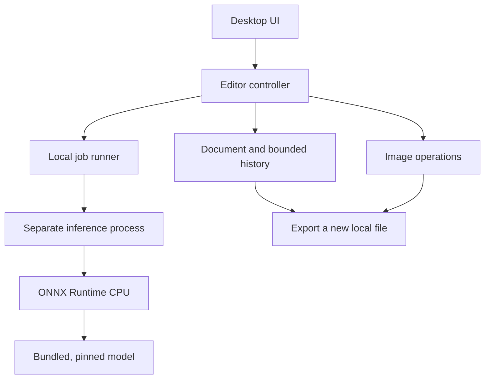

# Architecture

Decision date: 2026-10-12. Status: accepted for the initial alpha; package and hardware support require verification.

## Stack

Use Python 3.12, PySide6/Qt Widgets for the desktop UI, Pillow and NumPy for conventional image operations, and ONNX Runtime's CPU execution provider for the first neural network. Use Nuitka through Qt's documented deployment approach to bundle the runtime, and a Windows installer or portable directory for distribution.

Python owns application behaviour; native libraries perform image processing and inference. Avoid per-pixel Python loops. Qt Widgets keeps the first UI and its logic in one language. QML remains an option if a later design demonstrably needs it; introducing Python, TypeScript, and Rust at once is unnecessary for this scope.

## Component boundaries

`core/` has no dependency on Qt, the inference engine, or networking. `ui/` owns widgets, translations, preview rendering, and orchestration. `ai/` owns model verification, preprocessing, inference, and output compositing. Build-time network code lives only in `tools/prepare_model.py`.

The dependency direction is from UI/adapters to the core. There is one repository and one shipped application, not multiple remotely deployed services. The child process exists for UI responsiveness, cancellation, and memory recovery; it is not an OS security sandbox.

## Document behaviour

Import normalizes EXIF orientation and converts a valid embedded ICC profile into sRGB. Images without a profile are treated as sRGB; an invalid profile must produce an understandable error rather than silently changing colours. The initial working format is 8-bit RGBA. This is a deliberate MVP limit, not a RAW/HDR or professional colour-grading pipeline.

The original decoded image is retained and never mutated. UI previews use a scaled copy. Editing operations produce a new result, which the document accepts as a history step. Undo/redo uses bounded snapshots for the initial single-image application. This is simpler than a full dependency graph and makes AI results exactly recoverable. A labelled operation journal plus on-disk tile/cache storage can replace snapshots when persistent projects and larger images justify it.

The initial import limit is 40 million pixels. The default combined history budget is 256 MiB, excluding the original, current image, working arrays, model and UI previews. Large images therefore retain fewer undo steps. This is not a promise of a fixed total RAM limit; native decoders and inference allocations must be measured on target hardware.

Export writes to a temporary file beside the destination and atomically replaces the destination after success. The source file, resolved aliases, and hardlinks to it must be refused. The UI confirms replacing any other existing export. Exports remove imported EXIF/GPS/comment metadata and contain a deliberate sRGB output profile. JPEG alpha is composited onto white.

## Inference jobs

The controller creates a private temporary job directory and stores a normalized PNG. It launches the same packaged executable with `--worker <job-directory>`; development uses `python -m local_ai_photo_editor` with the same arguments. A small versioned JSON request allows only predefined operations. Results and completion information are written into the job directory. Photos are not passed on a command line or sent to a local web service.

Only one inference job is active. Editing controls are disabled for the active job, and a revision identifier prevents a late result from being applied to another document. A Cancel action terminates that job; the controller waits for process exit before deleting its files. Closing the window also stops the worker. All result sizes and formats must be validated before application.

No HTTP server, open TCP port, CORS configuration, API token, or browser origin policy is needed. This does not establish a security boundary against another process running under the same OS user.

## Model loading

The initial inference adapter accepts only a known file shipped beside the application with a fixed SHA-256 and size. The model is loaded from verified bytes to avoid a path changing between validation and inference initialization. Runtime model discovery does not scan arbitrary folders or load arbitrary downloaded code.

Preprocessing and compositing are independent functions with tests. The U2NETP model receives a 320×320 tensor using the upstream preprocessing convention. The output mask is resized to the image size and multiplied with any existing alpha. Foreground colour pixels remain the source pixels. Thus background removal does not redraw the face or clothing, although imperfect masks can still remove wanted pixels.

The CPU provider is the supported MVP target after its package tests pass. The presence of CUDA, DirectML, CoreML, or Windows ML upstream does not establish support in this application. Each future provider needs a matching model, a distributable runtime, target-device tests, fallback behaviour, and a published support matrix.

## Future generative adapter

FLUX.2 klein 4B is the first candidate for instruction-based image editing. Package its required text encoder, VAE, tokenizer and inference runtime as a versioned optional component. Keep inference local, disable implicit model downloads, and pin every artifact. Do not label the transformer file alone a complete AI package.

For a masked edit, preserve the original outside the accepted mask. Model output is a proposed result, not an automatic replacement. Store the actual generated pixels, mask, model revision and parameters in a future project file; a seed alone is not an exact reproducibility guarantee across runtime/hardware versions.

## Distribution

Windows 11 x64 is the initial target assumption. Use a standalone application directory inside an installer or portable ZIP, with the model already included. A single self-extracting executable would repeatedly unpack runtime/model data. Build and validate on Windows; a Linux source test is not a Windows installer test.

The build must collect dependency licenses, record resolved versions, verify the model, run headless and real-model checks, and then run the frozen executable. Signed installers and a clean-machine offline acceptance run are release requirements. No signing key or paid certificate is assumed to exist.

Sources: [Qt deployment](https://doc.qt.io/qtforpython-6/deployment/deployment-pyside6-deploy.html), [Qt package/licensing](https://pypi.org/project/PySide6/), [ONNX Python](https://onnxruntime.ai/docs/get-started/with-python.html), [FLUX.2 klein model card](https://huggingface.co/black-forest-labs/FLUX.2-klein-4B).

