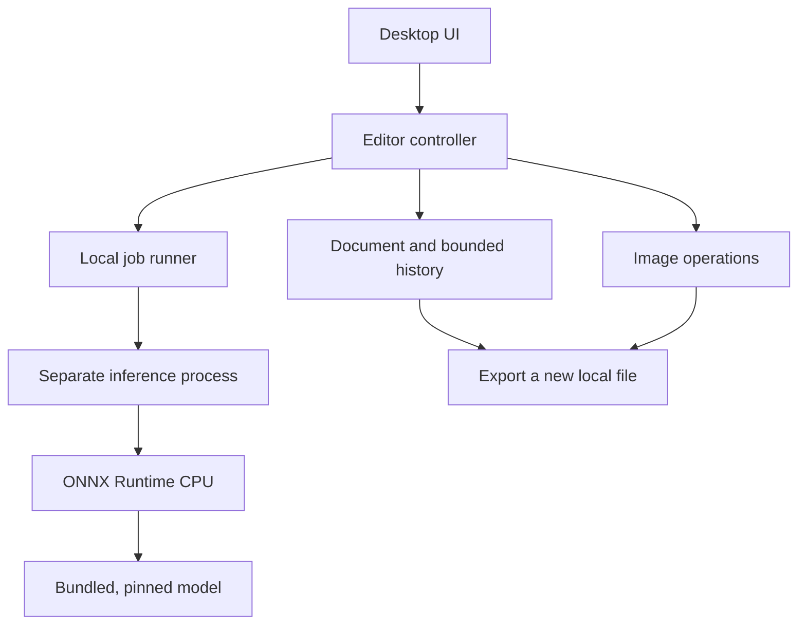

# Architecture

Decision date: 2026-10-12. Status: accepted for the initial alpha. Native and downloaded-package checks passed on Windows Server 2022, including actual model inference, the DE/EN UI and image import/export under an outbound network block for the application. Exact evidence is recorded in [VERIFICATION.md](VERIFICATION.md); clean Windows 11 acceptance and hardware support remain unverified.

## Stack

Use Python 3.12, PySide6/Qt Widgets for the desktop UI, Pillow and NumPy for conventional image operations, and ONNX Runtime's CPU execution provider for the first neural network. Use Nuitka 4.2.2 to bundle the runtime into a standalone Windows application directory, delivered as a portable ZIP. An installer remains a later distribution option.

Python owns application behaviour; native libraries perform image processing and inference. Avoid per-pixel Python loops. Qt Widgets keeps the first UI and its logic in one language. QML remains an option if a later design demonstrably needs it; introducing Python, TypeScript, and Rust at once is unnecessary for this scope.

## Component boundaries

`core/` has no dependency on Qt, the inference engine, or networking. `ui/` owns widgets, translations, preview rendering, and orchestration. `ai/` owns model verification, preprocessing, inference, and output compositing. Build-time network code lives only in `tools/prepare_model.py`.

The dependency direction is from UI/adapters to the core. There is one repository and one shipped application, not multiple remotely deployed services. The child process exists for UI responsiveness, cancellation, and memory recovery; it is not an OS security sandbox.

## Document behaviour

Import normalizes EXIF orientation and converts a valid embedded ICC profile into sRGB. Untagged RGB, greyscale and palette images are treated as sRGB; untagged CMYK and LAB inputs are rejected because the application does not guess their colour space. Invalid or unsupported profiles produce an error. The initial working format is 8-bit RGB or RGBA, preserving transparency when present. Animated/multipage inputs and unsupported higher-bit-depth modes are rejected. These are deliberate MVP limits; RAW/HDR and professional colour grading require a different pipeline.

The original decoded image is retained and never mutated. UI previews use a scaled copy. Editing operations produce a new result, which the document accepts as a history step. Undo/redo uses bounded snapshots for the initial single-image application. This is simpler than a full dependency graph and makes AI results exactly recoverable. A labelled operation journal plus on-disk tile/cache storage can replace snapshots when persistent projects and larger images justify it.

The initial import limit is 40 million pixels. The default combined history budget is 256 MiB, excluding the original, current image, working arrays, model and UI previews. Large images therefore retain fewer undo steps. This is not a promise of a fixed total RAM limit; native decoders and inference allocations must be measured on target hardware.

Export writes to a temporary file beside the destination and atomically replaces the destination after success. The source file, resolved aliases, and hardlinks to it must be refused. The UI confirms replacing any other existing export. Exports remove imported EXIF/GPS/comment metadata and contain a deliberate sRGB output profile. JPEG alpha is composited onto white.

## Local project files (source code after alpha.1)

A separate pure-Python core module, `core/project.py`, serializes the accepted document into versioned `.laip` ZIP archives. Files contain lossless normalized original/current PNGs, the retained Undo/Redo pixel snapshots and a JSON manifest with exact entry names, dimensions, SHA-256 digests, operation labels and history budget. The project does **not** store the original absolute filesystem path or imported EXIF/GPS/comment metadata. Loading enforces an exact entry allowlist, 40 MP frame limit, archive/manifest size budgets, checksum verification, valid PNG RGB/RGBA data and history consistency. It extracts no paths and executes no embedded code.

Save writes to a temporary file, flushes and atomically replaces the chosen project file. Failure must not corrupt the previous project or mutate the imported photo. The original path cannot be recovered when reopening a project; the UI therefore prohibits replacing pre-existing image exports on a restored project, except exports made during that same editor session. Project saves currently run synchronously and can block the UI for large images; that is a documented limitation, not a performance guarantee. The existing released v0.1.0-alpha.1 package does not yet contain this feature.

## Manual foreground mask refinement (development source)

The new `core/mask.py` is a Qt-free, inference-free Pillow rasterizer. A `MaskStroke` stores normalized pointer positions, brush diameter relative to the shorter image edge, feather fraction and restore/erase mode. The editor captures pointer movements on `PhotoCanvas`, previews them on a resized image, and applies them to the full-resolution accepted document only after explicit confirmation. Undo/Redo initially manages pending brush strokes; the accepted result becomes a single reversible `ImageDocument` history entry and is persisted automatically by the existing `.laip` snapshot format without a schema change.

Each stroke produces a bounded local grayscale brush region. A feathered or hard-edged raster mask composites **only** the source image's alpha toward 255 (restore) or 0 (erase); source RGB channels remain unchanged. Dimension and coordinate validation plus per-session stroke/point limits bound inputs. The existing normalizer enforces the 40 MP and 8-bit RGB/RGBA limits.

This is alpha repair rather than RGB inpainting or neural hair reconstruction: color contamination is untouched, originally transparent source pixels are not tracked separately as an alpha ceiling, and full-resolution application is synchronous. The generated preview is not pixel-identical to full-resolution rasterization at every edge. See [MASK_REFINEMENT.md](MASK_REFINEMENT.md). The existing private v0.1.0-alpha.1 package predates this source-only change.

## Inference jobs

The controller creates a private temporary job directory and stores a normalized PNG. It launches the same packaged executable with `--worker <job-directory>`; development uses `python -m local_ai_photo_editor` with the same arguments. A small versioned JSON request allows only predefined operations. Results and completion information are written into the job directory. Photos are not passed on a command line or sent to a local web service.

Only one inference job is active. Editing controls are disabled for the active job, and a revision identifier prevents a late result from being applied to another document. A Cancel action terminates that job; the controller waits for process exit before deleting its files. Closing the window also stops the worker. All result sizes and formats must be validated before application.

No HTTP server, open TCP port, CORS configuration, API token, or browser origin policy is needed. This does not establish a security boundary against another process running under the same OS user.

## Model loading

The initial inference adapter accepts only a known file shipped beside the application with a fixed SHA-256 and size. The model is loaded from verified bytes to avoid a path changing between validation and inference initialization. Runtime model discovery does not scan arbitrary folders or load arbitrary downloaded code.

Preprocessing and compositing are independent functions with tests. The U2NETP model receives a 320×320 tensor using the upstream preprocessing convention. The output mask is resized to the image size and multiplied with any existing alpha. Foreground colour pixels remain the source pixels. Thus background removal does not redraw the face or clothing, although imperfect masks can still remove wanted pixels.

The CPU provider is covered by the successful alpha package checks on Windows Server 2022. The presence of CUDA, DirectML, CoreML, or Windows ML upstream does not establish support in this application. Each future provider needs a matching model, a distributable runtime, target-device tests, fallback behaviour, and a published support matrix.

## Future generative adapter

FLUX.2 klein 4B is the first candidate for instruction-based image editing. Package its required text encoder, VAE, tokenizer and inference runtime as a versioned optional component. Keep inference local, disable implicit model downloads, and pin every artifact. Do not label the transformer file alone a complete AI package.

For a masked edit, preserve the original outside the accepted mask. Model output is a proposed result, not an automatic replacement. Store the actual generated pixels, mask, model revision and parameters in a future project file; a seed alone is not an exact reproducibility guarantee across runtime/hardware versions.

## Distribution

Windows 11 x64 remains the initial product target. The checked portable test alpha uses `LocalAiPhotoEditor-0.1.0-alpha.1-windows-x64.zip`, containing the top-level directory `LocalAiPhotoEditor/` with the application, runtime and bundled model. Extract the complete archive and run the EXE inside that directory. [Download](https://github.com/Cenn0/LocalAiPhotoEditor/releases/download/v0.1.0-alpha.1/LocalAiPhotoEditor-0.1.0-alpha.1-windows-x64.zip) · [Prerelease information](https://github.com/Cenn0/LocalAiPhotoEditor/releases/tag/v0.1.0-alpha.1). An installer remains a later packaging option.

The successful `Windows alpha` workflow produced the build artifact `LocalAiPhotoEditor-windows-x64-alpha` after 69 passing tests, actual model inference and native UI/image-I/O checks of the compiled executable. A separate workflow downloaded that exact artifact, verified its digest and ran its worker and GUI with a verified outbound firewall block for the same executable. No repository checkout, Python setup or project dependency installation took place in that second job. Build-artifact, executable and test-evidence identities are recorded in [VERIFICATION.md](VERIFICATION.md); the final release-archive checksum belongs to the separate `SHA256SUMS.txt` asset.

The alpha is unsigned. These checks used Windows Server 2022 with a restricted child-process environment, not a clean Windows 11 installation. Full interactive acceptance remains open. A signed Windows package and the existing clean-machine offline acceptance are requirements before the first stable end-user release. No signing certificate is assumed to be available.

Sources: [Qt deployment](https://doc.qt.io/qtforpython-6/deployment/deployment-pyside6-deploy.html), [Qt package/licensing](https://pypi.org/project/PySide6/), [ONNX Python](https://onnxruntime.ai/docs/get-started/with-python.html), [FLUX.2 klein model card](https://huggingface.co/black-forest-labs/FLUX.2-klein-4B).

