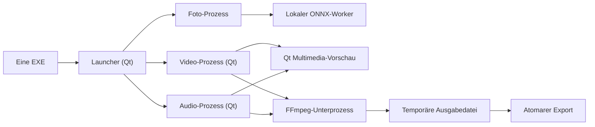

# Edivora – Launcher, Video & Audio MVP (Entwicklungsstand)

**Stand:** 14.10.2026, aktuellere Quellcodeentwicklung auf Basis des gemergten Media-MVP. Dieses Dokument ersetzt weder einen erfolgreichen Windows-Build noch einen auf einem sauberen Windows-11-System geprüften Release. Das veröffentlichte `v0.1.0-alpha.1` ist weiterhin nur der ältere Fotoeditor.

## Ein Programm, drei voneinander unabhängige Fenster

`Edivora.exe` (im jetzigen Windows-Build weiterhin `LocalAiPhotoEditor.exe` genannt) öffnet ohne Argumente den **Edivora Launcher**. Die Startansicht zeigt Foto, Video und Audio mit jeweils einem **Öffnen**-Knopf und einer separaten Checkbox **Auswählen**. Mit **Ausgewählte Werkzeuge öffnen** können beliebige Kombinationen von einem, zwei oder drei verschiedenen Editoren gleichzeitig geöffnet werden. Der Launcher bleibt geöffnet und kann erneut Werkzeuge starten.

Technisch startet der Launcher für jede Wahl **eine neue Instanz derselben EXE**:

- `LocalAiPhotoEditor.exe --tool photo`: unveränderter funktionaler Fotoeditor mit lokaler KI.
- `LocalAiPhotoEditor.exe --tool video`: eigenständiges Video-MVP.
- `LocalAiPhotoEditor.exe --tool audio`: eigenständiges Audio-MVP.
- Ohne Parameter oder `--launcher`: Startauswahl.

Im Entwicklungscheckout genügt `python -m local_ai_photo_editor`; einzeln oder parallel über `python -m local_ai_photo_editor --tool video` und `--tool audio`. Für den fertigen portablen Windows-Build braucht der Anwender kein Python oder separat installiertes FFmpeg. **Wichtig:** Die EXE ist *keine Onefile-Datei*; alle DLLs, das KI-Modell und `media-tools/ffmpeg.exe` verbleiben im mitgelieferten Ordner. Eine einzelne verschobene EXE funktioniert nicht.

Der Fotoeditor bietet zusätzlich aktive Video- und Audio-Schaltflächen, die die jeweils andere Editorinstanz starten und den aktuellen Fotostand nicht verwerfen. Schließen eines Editorfensters beendet keine anderen Prozesse.

## Funktionsumfang

| | Video-MVP | Audio-MVP |
| --- | --- | --- |
| Öffnen | MP4, MOV, MKV, WebM, AVI, M4V (container-/codecabhängig) | WAV, MP3, M4A, AAC, FLAC, OGG, Opus (codecabhängig) |
| Vorschau | Videobild und Ton mit Qt Multimedia | Audio mit Qt Multimedia, separate Wellenform über FFmpeg |
| Bearbeiten | Interaktiver Schnittbereich (verschiebbare Start-/Endmarken), Sekundenfelder, Bereichsvorschau, Lautstärke, Ton stummschalten | Interaktiver Schnittbereich, Sekundenfelder und separate Wellenform, Lautstärke, optionale Loudness-Normalisierung und Fades |
| Export | MP4: MPEG-4 Part 2 + AAC | WAV: PCM 16-bit/48 kHz/Stereo oder MP3: 192 kbit/s |
| Persistenz | Neue Videodatei, **kein** natives Schnittprojekt | Neue Audiodatei, **kein** natives Schnittprojekt |

Das erste MVP besitzt **eine Datei und eine zusammenhängende Auswahl** pro Editorfenster. Es enthält noch kein Clip-Arrangement, mehrere Spuren, Übergänge, Keyframes, Undo/Redo für Bearbeitungsschritte, Untertitel, Bildfilter oder KI-Verarbeitung für Video/Audio. Die separate Audio-Wellenform ist eine Anzeige, ihre letzten Abschnitte können bei Clips über 15 Minuten fehlen. **Start und Ende** lassen sich nun sowohl über numerische Felder als auch durch Ziehen der zwei Schnittmarken auf der Zeitleiste setzen; die Markierungen beziehen sich immer auf die **gesamte Dateidauer**, nicht nur die gegebenenfalls verkürzte Wellenformanzeige. Der Videoexport nutzt bewusst den verbreiteten MPEG-4-Part-2-Encoder, nicht H.264 und keine professionelle Codec-/Qualitätsauswahl; Wiedergabekompatibilität variiert je nach Abspielgerät. Der eingebaute Player verwendet **Qt Multimedia** und hat eine vom FFmpeg-Export unabhängige Decodierunterstützung – nicht jede Datei, die FFmpeg verarbeiten kann, muss in der Vorschau spielen.

**Anwenderablauf:** Datei öffnen oder ins Fenster ziehen → Start-/Endmarke auf der Zeitleiste ziehen oder Sekundenfelder benutzen → Play zur Vorschau → optional Ton bearbeiten → **Als neue Datei exportieren** → Speicherort wählen und ggf. Ersetzen bestätigen → Abschlussstatus. Beim Export bleibt die App bedienbar, die betreffenden Editierregler sind gesperrt und **Abbrechen** beendet den Kodierer. Mehrere Editoren arbeiten unabhängig.

## Visuelle Schnittauswahl (neuer Entwicklungsstand)

Die Zeitleiste liegt in beiden Editoren direkt unter dem Wiedergaberegler. Der **eingefärbte Bereich** wird exportiert; die grauen Bereiche werden verworfen. Eine separate farbige Linie zeigt die aktuelle Wiedergabeposition. So funktioniert die Bearbeitung:

1. **Schnittmarken verschieben:** Anfang/Ende lassen sich unabhängig voneinander mit der Maus ziehen. Der Bereich bleibt mindestens 0,1 Sekunden lang.
2. **Abspielposition ändern:** Auf die Leiste außerhalb der beiden Marken klicken. Dies bewegt nur den Abspielkopf; der Exportbereich ändert sich dadurch nicht.
3. **Hier beginnen / Hier enden:** Die aktuelle Wiedergabeposition wird zum Anfang oder Ende des Ausschnitts, begrenzt auf eine gültige Auswahl.
4. **Gesamte Datei verwenden:** Start- und Endmarke zurücksetzen. Die präzisen Sekundenfelder rechts lassen sich weiterhin direkt bearbeiten.
5. **Tastatur:** Zeitleiste fokussieren, gewünschte Schnittmarke mit der Maus auswählen, dann mit **Pfeil links/rechts** um 0,1 s oder mit **Umschalt + Pfeil** um 1 s ändern. Für vollständige Tastatur- und Screenreader-Bedienung dienen die separaten numerischen Felder als Alternative.

Eine Änderung der Zeitleiste aktualisiert sofort die numerischen Eingaben. Der bereits validierte FFmpeg-Export nimmt exakt dieselbe Start-/Endauswahl. Bei unzulässigen Werten (z. B. Fades länger als der neue Audiobereich) wird Export deaktiviert, bis die Einstellungen wieder zusammenpassen. Das Anfassen eines Markers pausiert die Wiedergabe und zeigt die neue Abspielposition an. Video bleibt bei einer Datei, Audio bei einer Datei; die Markierungen sind noch keine Clips auf mehreren Spuren.

Die neuen UI- und Export-Verknüpfungstests laufen in der Windows- und Linux-CI. Der Windows-Standalone-Test muss auf dem konkreten neuen Commit erfolgreich sein, bevor dieses Teil-Feature als **getestetes Paket** bezeichnet werden darf.

## Datenschutz und Dateischutz

- Keine Runtime-Downloads, Cloud-Aufrufe, API-Schlüssel oder Telemetrie. `imageio-ffmpeg` liefert beim *Build* eine feste lokale FFmpeg-Binärdatei.
- FFmpeg wird ohne Shell aufgerufen; `-protocol_whitelist file,pipe,data` beschränkt die bei der Eingabe akzeptierten Protokolle. Decoder verarbeiten trotzdem nicht vertrauenswürdige Mediendaten; das Werkzeug ist **keine** Sicherheitssandbox.
- Eingabedateien werden nicht beschrieben. Gleiche Pfade, aufgelöste Symlinks und bestehende Hardlinks zum Original werden beim Export abgelehnt. Ein temporäres Ergebnis im Zielordner wird erst bei erfolgreichem Prozess und nichtleerem Output per `os.replace` installiert.
- Bei Export in bestehende andere Dateien fragt die UI vorab nach. Ein Crash kann eine temporäre Datei `.edivora-…` zurücklassen. Es gibt keine projektinterne Backup-/Autosave-Funktion.
- Medien werden exportiert ohne Kopie der ursprünglichen Metadaten oder Kapitel. Bei Bild-/Tonverarbeitung wird neu kodiert und es kann Qualitätsverlust auftreten.
- Das MVP beschränkt den Eingabedateiumfang auf 20 GiB. Ein unbekannter oder von Qt nicht ermittelbarer Zeitwert sperrt den Export statt eine willkürliche Dauer anzunehmen.
- Ein vom Benutzer gewählter synchronisierter Zielordner ist nicht „offline“ gegenüber dessen Synchronisationssoftware.

## Architektur



Quellen: `src/local_ai_photo_editor/__main__.py` (Argumentrouting), `ui/launcher.py`, `ui/media_window.py`, `core/media.py` (Qt-freie Validierung/Exportkommandos), `ui/media_strings.py` (DE/EN), `media_smoke.py` (synthetische Smoke-Tests).

## Entwicklung, Tests und Windows-Build

```powershell
py -3.12 -m venv .venv
.venv\Scripts\python -m pip install -e . Nuitka==4.2.2
$env:PYTHONPATH='src'
.venv\Scripts\python -m unittest discover -s tests -v
.venv\Scripts\python -m compileall -q src tests tools
.venv\Scripts\python -m local_ai_photo_editor --media-smoke-test test-results/media
.venv\Scripts\python tools/prepare_model.py
.venv\Scripts\python tools/build_windows.py
```

Ein erfolgreicher Windows-Build wird als *kompletter* Ordner `dist/LocalAiPhotoEditor/` ausgegeben; `LocalAiPhotoEditor.exe` ist dessen Einstiegspunkt. `.github/workflows/windows-alpha.yml` testet Quell- und gepackte EXE mit synthetischen Medien und drei Qt-Fenster-Screenshots. Das ersetzt keine manuelle UX-/Audio-/Videowiedergabe- und Windows-11-Abnahme für reale Dateien; eine grüne CI-Gesamtprüfung muss abgewartet werden.

### Lizenzgrenze vor Veröffentlichung

Die `imageio-ffmpeg==0.6.0`-Wheel-Binärdatei enthält externe FFmpeg-Codecs. Bei Weitergabe des EXE-Pakets sind **die genauen Build-Flags, die tatsächliche GPL-/LGPL-Lizenz und zugehörige korrespondierende Quelltexte** zu prüfen und gesetzeskonform bereitzustellen. Das bloße Beilegen eines GPL-Lizenztextes ist keine vollständige Erfüllung. Der Windows-Build trägt deshalb explizit den Hinweis `media_license_review`. Für ein öffentlich vertriebenes Paket muss diese Lizenzprüfung abgeschlossen werden; parallel gelten die bestehenden Qt-/ONNX-Modell-Hinweise aus `THIRD_PARTY_NOTICES.md`.

## Späterer Ausbau

Geplant, noch **nicht** implementiert: Clip-Reihenfolge und mehrspuriges Audio (die neue einfache Ein-Datei-Schnittzeitleiste ist keine Multitrack-Timeline), nicht-destruktive lokale Projekte und Undo/Redo, interaktive Wellenform-Auswahl, weitere Exportprofile, lokale KI für Transkription/Rauschminderung/Untertitel sowie echte Nutzertests und Lizenz-/Codec-Matrix.
